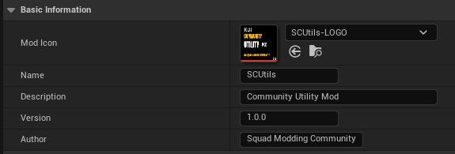
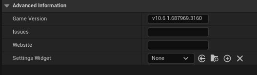
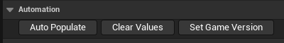

# Squad Community Utility Mod (SCUtils)

SCUtils is a library of simple utility functions.

## Table of Contents
- [0. BP ModInfo](#0-bp_modinfo)
    - [0.1 Basic Information](#01-basic-information)
    - [0.2 Advanced Information](#02-advanced-information)
    - [0.3 Automation](#03-automation)
    - [0.4 Steam Merging](#04-steam-merging)
    - [0.5 Get Functions](#05-get-functions)
- [1. BP SCU Server Info Component](#1-bpc-gs-server-info)
    - [BP Mod Info Replication](#11-bp-mod-info-replication)
    - [Steam Mod Info Replication](#12-steam-mod-info-replication)
- [2. BP SCU Player Controller Component](#2-bpc-player-controller)
    - [Client Mod Info Setup](#21-client-mod-info-setup)
    - [Client Report Version Errors](#22-client-validate-server-mod-infos)
    - [Client Report Version Errors](#23-client-report-version-errors)
        - [Mod Version](#23a-mod-version-error)
        - [Game and Steam Version](#23b-game-and-steam-version-errors)
    - [Allow HUD Game Features](#24-allow-hud-game-feature)
- [3. BPFL Utility](#3-bpfl-util)
    - [Logging](#31-logging)
        - [Get Object Plugin Folder](#31a-get-object-plugin-folder)
    - [Add Component(s) by Class](#32-add-components-by-class)
    - [Get Server Info Component](#33-get-server-info-component)
    - [Get Controller SCU Component](#34-get-controller-scu-component)
    - [Get Major Minor Version](#35-get-major-minor-version)
- [4. BP ControlsUI Component](#4-bp-controlsui-component)
- [5. BP Mappings](#5-bp-mappings)
- [6. BPFL Math](#6-bpfl-math)
- [Credits](#credits)

## 0. BP ModInfo
The ModInfo BP contains basic information of a mod that'll help users understand what they are using. The main purpose is Mod and Game version compatibility checking. Secondary information can be included such as an in-game widget for configuration of mod data.

#### 0.1 Basic Information 
This info should immediately convey what this mod is and does to the user.
- Mod Icon [ texture reference ]
- Name [ string ] 
- Description [ multi-line string ]
- Version [ string ]
    - Versions are arbitrary and can range from simple integer versions (1,2,3...) to more complex versions (20.8.5+PUBLIC)
- Author [ string ]

>Since versions are arbitrary there is no way to differentiate which version is newer. A simple 'is exactly equal' is used.  
>Name, Description, Version and Author must be set otherwise BP will fail to validate.

#### 0.2 Advanced Information
This section contains information that the user does not need directly such as:
- Game Version
- Issues support link 
- Website link
- Settings Widget

>Game version must be set otherwise BP will fail to validate

#### 0.3 Automation
Some functions have been provided to automate the initial setup process
- Auto Populate
- Clear Values
- Set Game Version

#### 0.4 Steam Merging
The game provides mod information from Steam such as:
- Name
- Description
- Mod Hash
- File Size

we can paste Mod ID in BP Mod Info to merge BP and Steam Info to provide addition information such as:
- Game Version
- Issues/Bug Report Link
- Website Link
- Settings Widget

#### 0.5 Get Functions
All variables are private and cannot be changed at runtime, as such there are Get functions for those variables.

| Get Function            | Return Type                            |
| ----------------------- | -------------------------------------- |
| Version                 | String                                 |
| Author                  | String                                 |
| Name                    | String                                 |
| Issues                  | String                                 |
| Load Settings Widget    | Class -> User Widget                   |
| Settings Widget         | Soft Class -> User Widget              |
| Website                 | String                                 |
| Mod Icon                | Soft Object -> Texture 2D              |
| Load Mod Icon           | Object -> Texture 2D                   |
| Description             | String                                 |
| Game Version            | String                                 |
| Steam Populate          | Bool                                   |
| Steam ID                | String                                 |
| Use Steam Version       | Bool                                   |

## 1. BP SCU Server Info Component

#### 1.1 BP Mod Info Replication
Server collects and replicates its BP Mod Info Soft Object References + Mod Version String, this allows clients to load the local object and compare the strings
#### 1.2 Steam Mod Info Replication
Server collects and replicates any found SQMod Info IDs + Mod Version String. Clients will attempt to load the SQMod Info struct by ID and check Version.

## 2. BP SCU Player Controller Component

#### 2.1 Client Mod Info Setup
Client collects local BP Mod Infos and SQMod Infos in order to display information locally in external `Mod Menus`
#### 2.2 Client validate Server Mod Infos
Upon replication of `Server BP Mod Infos`, Client will load and compare mod version. `Steam Mod Infos` will also be checked when they're replicated.
#### 2.3 Client Report Version Errors
Client will build a "report" of any version errors found and replicate up to server
##### 2.3a Mod Version Error
Mod version errors will replicate up to server and notify player
##### 2.3b Game and Steam Version Errors
Game and Steam version errors will <b>NOT</b> replicate to server and will <b>ONLY</b> notify player
#### 2.4 Allow HUD Game Feature 
Once the HUD is ready it will be added as Receiver to Game Framework Component Manager so GF data assets can add components to HUD

## 3. BPFL Util

#### 3.1 Logging
Simple logger that will log to SquadGame.log and PrintString when in PIE. This logger grabs the root folder of the current object and displays it with the accompanied message. Making it easier for Modders/Users to distinguish where the logs are coming from.
#### 3.1a Get Object Plugin Folder
Returns the root folder of the object class path
#### 3.2 Add Component(s) by Class
Will attempt to add component(s) by the specified Actor Component class if the component does not already exist on the actor
#### 3.3 Get SCU Server Component
Returns `BP_SCU_ServerInfoComponent` component.
#### 3.4 Get Controller SCU Component
Returns `BP_SCU_PlayerControllerComponent` component.
#### 3.5 Get Major Minor Version
Pass the raw game version and it will return the major and minor version numbers are a single string

## 4. BP ControlsUI Component
Will Get all assets of class BP_Mappings and inject the mapping names and keys to Squad Controls UI

## 5. BP Mappings
Data Asset Container of an array of Input Mapping Contexts

## 6. BPFL Math

#### 6.1 Trim File Size With SQSize Enum
Takes an INT64 and returns the size in bytes/kb/mb etc. Divides by 1000

## Credits

- [SCSDK Community](https://discord.gg/yGQGHnXS5m)
- [Deathripper](https://github.com/Deathripper4133) - Project Manager
- [Stepan Sidorovich](https://github.com/stepansi) - Contributor
